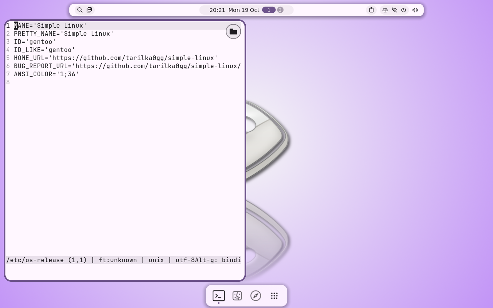
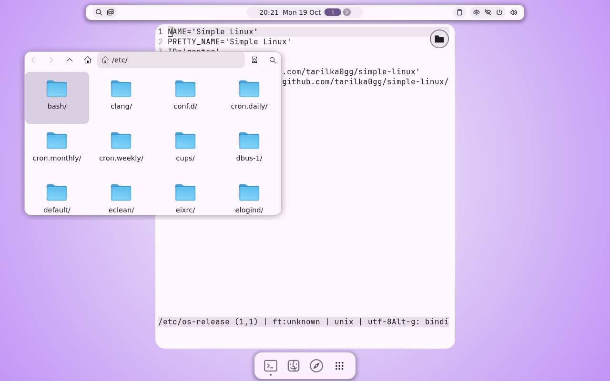
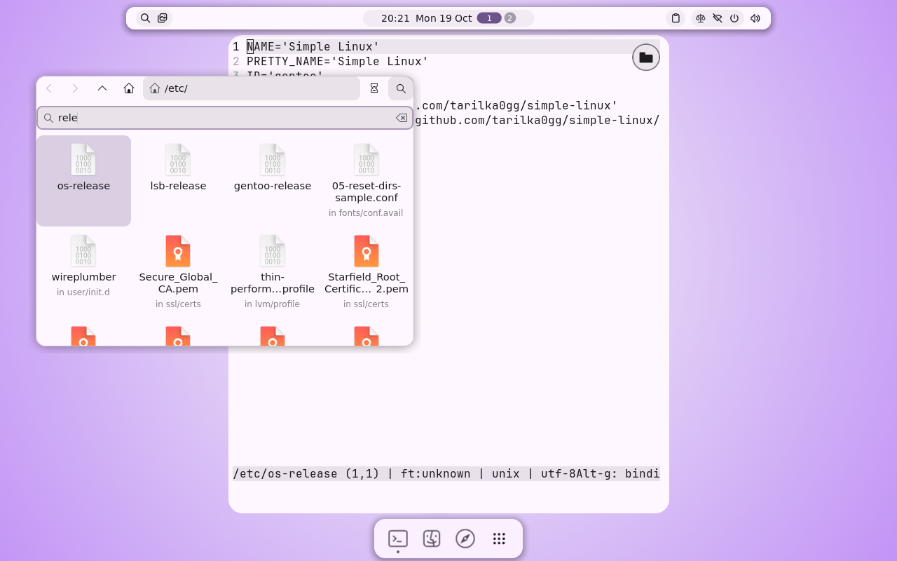
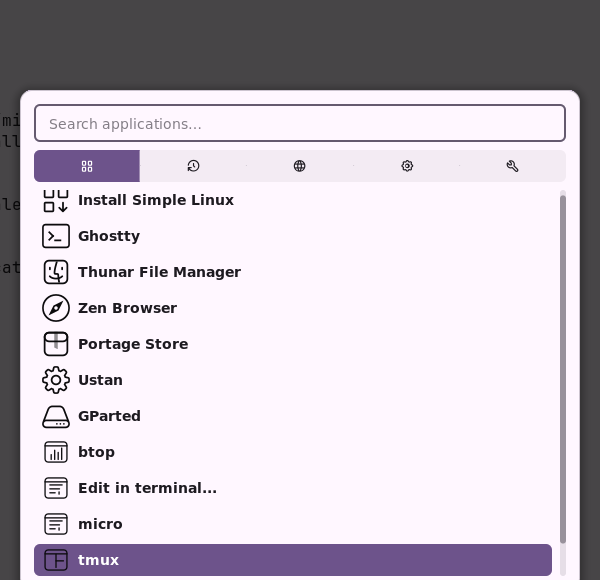
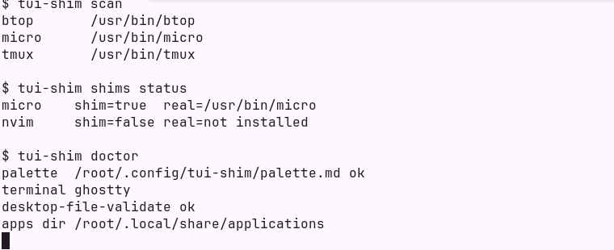

# tui-shim

[](https://github.com/tarilka0gg/tui-shim/actions/workflows/ci.yml) [](LICENSE) [](CHANGELOG.md)

> **Integrating this into Simple Linux / the ISO? Read [docs/INTEGRATION.md](docs/INTEGRATION.md) first.**
> It explains how everything works, what must not be forgotten and how to package it.

**Editor file picker.** In a terminal (ghostty), micro and nvim get a small round folder badge in the window's top-right corner.
Click it (or press F9) for a native file browser; the chosen file opens in the same editor window. With no file given the picker
opens by itself. Enabled by `tui-shim shims install` (puts `micro`/`nvim` shims in `~/.local/bin`) or by the launcher entries.
The picker's filter ignores case (`DEsktop` finds `Desktop`, `desktop`, `DeSKtop`...), ranks exact and prefix matches first and
searches sub-folders too. Details, limits and the design rationale are in `docs/INTEGRATION.md`.

## Screenshots

<table>
  <tr>
    <td width="50%"><a href="docs/img/badge.png"></a></td>
    <td width="50%"><a href="docs/img/picker.png"></a></td>
  </tr>
  <tr>
    <td><b>Folder badge</b><br><sub>micro and nvim get a small round folder badge in the window's top-right corner; click it or press F9.</sub></td>
    <td><b>File picker</b><br><sub>A native browser with folders and files; Enter opens the file in the same editor window.</sub></td>
  </tr>
  <tr>
    <td width="50%"><a href="docs/img/picker-search.png"></a></td>
    <td width="50%"><a href="docs/img/launcher.png"></a></td>
  </tr>
  <tr>
    <td><b>Search</b><br><sub>Case-insensitive; exact and prefix matches first; sub-folders are searched too.</sub></td>
    <td><b>Launcher entries</b><br><sub>One entry per TUI app, with an icon and its own window class, plus Edit in terminal...</sub></td>
  </tr>
  <tr>
    <td width="50%"><a href="docs/img/cli.png"></a></td>
    <td></td>
  </tr>
  <tr>
    <td><b>Command line</b><br><sub>tui-shim scan, shims status and doctor.</sub></td>
    <td></td>
  </tr>
</table>

<sub>Taken in the Simple Linux live session in a virtual machine; click a picture to see it full-size.</sub>

Scans for known TUI apps (btop, htop, yazi, micro, nvim, tmux, ...), then for each one:

- writes a launcher `.desktop` entry that opens it in your terminal with its own window class
- finds an icon: installed icon themes first, then Dashboard Icons / simple-icons, then a generated glyph
- recolors it from your system palette (per-app theme file where the app supports one, terminal ANSI override otherwise)

```
tui-shim scan [--unknown]     # what's installed (--unknown: heuristic scan for unlisted ncurses apps, slow)
tui-shim sync [APP] [--force] # entries + icons + themes (idempotent)
tui-shim theme [APP]          # themes only
tui-shim clean                # remove only entries/icons it created
tui-shim choose [APP]         # pick system vs user-installed copy (floating picker)
tui-shim edit [FILE] [--new]  # "Open with" editor picker, or start a new file
tui-shim open APP [FILE]      # start an editor with the badge/picker (what the launchers and shims call)
tui-shim shims [install|remove|status]  # make plain `micro`/`nvim` use it
tui-shim niri-rule            # optional window-rule snippet (not needed by the picker)
tui-shim doctor
```

## In Simple Linux
[Simple Linux](https://github.com/tarilka0gg/simple-linux) ships it: the fish setup runs `tui-shim shims install` and
`TUI_SHIM_LINE_ICONS=1 tui-shim sync --no-theme --offline` once per user (line-drawn launcher icons: Noctalia turns coloured or
filled theme icons into black squares; `--no-theme` because Noctalia colours btop and yazi itself; `--offline` because icons are generated).
The palette comes from the wallpaper: a Noctalia hook (`colors.d/30-tui-shim.sh` in
[simple-linux-configs](https://github.com/tarilka0gg/simple-linux-configs)) rewrites `~/.config/tui-shim/palette.md` after every palette change, colours micro from it
and redraws the icons. The installer copies the `tui-shim` binary into the installed system. Details for packagers: [docs/INTEGRATION.md](docs/INTEGRATION.md).

## Several copies of one program
`~/.cargo/bin/yazi` next to `/usr/bin/yazi`: `scan`/`list` show every distinct copy (merged-usr symlinks are
deduplicated). Without a saved choice the first one in lookup order wins. `choose` stores your pick in
`~/.config/tui-shim/choices.toml`; `sync` keeps honouring it and never silently switches.
`sync` also writes two helper launchers: "TUI app versions" (the chooser) and "Edit in terminal..." which is
offered for text files in "Open with" (it does not take over any default; mimeapps.list is untouched) and has a
"New file..." action. Both run in a window with class `tui-shim.picker`.

Global: `--dry-run`, `--offline`, `--palette FILE` (or `TUI_SHIM_PALETTE`).
Default palette: `~/.config/futuro-darko/palette.md` (markdown tables of `name | #HEX`).

Apps are described in `registry/*.toml`; theme templates live in `templates/` with `{{palette_key}}` placeholders.
Config files tui-shim edits are backed up once as `*.bak-tui-shim`; files not created by it are skipped without `--force`.

## Build
Rust 2024 edition. GTK4, libadwaita and gtk4-layer-shell (for the picker) are optional: `cargo build --release --no-default-features`
builds the launcher/theme tooling without them. The badge needs a terminal with the kitty graphics protocol (ghostty, kitty);
opening the picker next to a scrolled niri window uses `grim`. A Gentoo live ebuild is in `packaging/gentoo/`.

## Changelog

What changed in each version is in [CHANGELOG.md](CHANGELOG.md).

## License
GPL-3.0-or-later, see [LICENSE](LICENSE). Changes are listed in [CHANGELOG.md](CHANGELOG.md).
